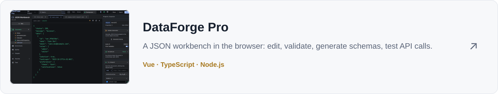
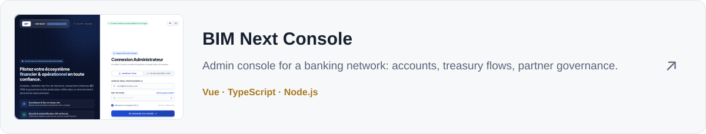
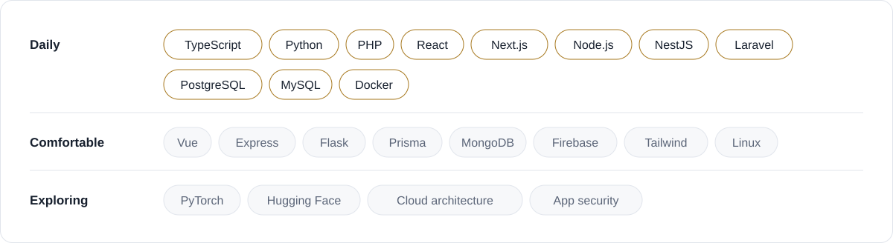

<picture>
  <source media="(prefers-color-scheme: dark)" srcset="./assets/header-dark.svg">
  
</picture>

 

I design and ship web products end to end — data model, API, interface and
deployment. I care about software that stays simple to change: clear service
boundaries, boring infrastructure, and interfaces that load fast on the
networks people actually use.

 

### Selected work

<a href="https://github.com/LeaderMushio/project-one">
<picture>
  <source media="(prefers-color-scheme: dark)" srcset="./assets/project-1-dark.svg">
  
</picture>
</a>

<a href="https://github.com/LeaderMushio/project-two">
<picture>
  <source media="(prefers-color-scheme: dark)" srcset="./assets/project-2-dark.svg">
  
</picture>
</a>

<a href="https://github.com/LeaderMushio/project-three">
<picture>
  <source media="(prefers-color-scheme: dark)" srcset="./assets/project-3-dark.svg">
  
</picture>
</a>

 

### Stack

<picture>
  <source media="(prefers-color-scheme: dark)" srcset="./assets/stack-dark.svg">
  
</picture>

 

### How I work

- Small, reviewed pull requests over large rewrites
- Tests where bugs would be expensive, not everywhere by habit
- Documentation written for the next person, including future me

 

<picture>
  <source media="(prefers-color-scheme: dark)" srcset="./assets/divider-dark.svg">
  
</picture>

  <a href="https://linkedin.com/in/leader-mushio-4b7a3923b">LinkedIn</a> &nbsp;·&nbsp;
  <a href="mailto:leadermushio377@gmail.com">Email</a> &nbsp;·&nbsp;
  <a href="https://ko-fi.com/V7V4RAK9C">Ko-fi</a>

